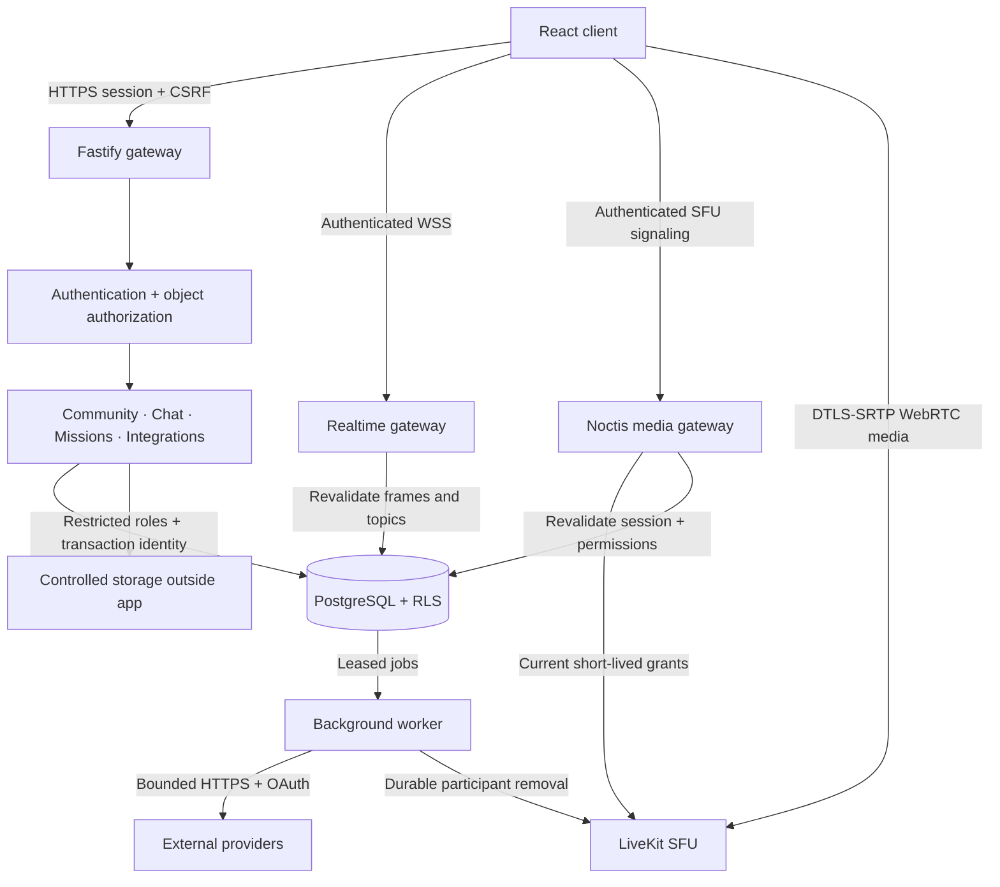

# Architecture and API

## Service boundaries

`server/app.ts` owns parsing, headers, hooks and safe errors. Authentication, authorization, crypto and database access have dedicated modules. `domain/` implements community, chat and mission operations. Storage, realtime, integrations and worker modules isolate supporting services.

The browser receives filtered DTOs, never database credentials, password hashes, OAuth tokens or session bearer values. `src/api.ts` handles transport. `src/store.ts` retains a server snapshot and maps UI intents to explicit endpoints; there is no bulk state-write API.

## Persistence

Checksum-verified migrations in `server/migrations` normalize identities/devices/sessions; communities/members/categories/channels; messages/replies/reactions/mentions/attachments/pins; direct conversations; roles/permissions/assignments/overrides; invitations; missions/objectives/progress/rewards/XP/badges; events/RSVPs; notifications; friendships/blocks; integrations/credentials/items; webhooks/deliveries/jobs; moderation/audit; presence/voice/signaling; upload cleanup.

Foreign keys, unique constraints, bounded fields, timestamps, soft deletion and partial/full-text indexes enforce structure. Leaderboards aggregate the XP ledger rather than duplicate scores. JSON is reserved for flexible metadata and external payloads.

Transactions atomically create community defaults, messages/mentions, rewards, invite redemption and moderation. Advisory locks serialize mission claims and role/voice changes; invite rows serialize use counters. Message nonces are unique per author. Jobs use SKIP LOCKED leases, backoff, bounded retries and idempotent delivery IDs.

The non-superuser roles `noctis_api`, `noctis_auth`, `noctis_worker`, `noctis_migrator` have separate grants. The API role does not own tables. RLS checks transaction-local identity and live sessions. Migration credentials are absent from API/worker containers. Separate pools restrict capabilities within a trusted process; they are not process isolation against arbitrary code execution.

## API conventions

Routes use `/api`. JSON mutations need the configured Origin, live cookie and `X-CSRF-Token`. Login/register and signed webhook/OAuth callbacks have separate validation. Strict schemas reject unknown fields. Safe errors include a request ID. Lists are bounded; history uses cursors.

| Domain          | Routes                                                                                                               |
| --------------- | -------------------------------------------------------------------------------------------------------------------- |
| Identity        | `/auth/register`, `/auth/login`, `/auth/logout`, `/auth/session`, `/auth/account`, `/auth/devices`, `/auth/password` |
| Snapshot/search | `/bootstrap`, `/search?q=…`                                                                                          |
| Communities     | `/servers`, `/servers/:id`, `/servers/:id/join`, `/servers/:id/membership`                                           |
| Channels/roles  | Server categories/channels/roles/member assignment; channel overrides                                                |
| Messages        | `/rooms/:room/messages`, `/rooms/:room/read`, `/messages/:id`, restore/reactions/pin                                 |
| Social          | `/conversations`, `/profile`, `/settings`, `/friends`, `/blocks/:id`                                                 |
| Missions        | `/missions`, join/objective progress/claim/archive; server leaderboard                                               |
| Events          | `/events`, RSVP/cancel                                                                                               |
| Invites         | Create/revoke/send under server; preview/redeem under `/invites/:token`                                              |
| Files           | `/uploads?purpose=message&room=…` or avatar; presets; controlled `/uploads/:id`                                      |
| Administration  | Server moderation/bans/audit/webhooks                                                                                |
| Providers       | Integration connect/disconnect; OAuth start/callback                                                                 |
| Operations      | `/health` process liveness, `/ready` database readiness                                                              |

Route schemas in `server/` are authoritative for verbs, fields and limits. Room keys are URI-encoded `serverId/channelSlug` or `dm/userId|conversationId`. Discovery exposes public metadata only, not private channels/messages.

## Realtime and media

Same-origin authenticated upgrades require a CSRF first frame within five seconds. Every frame verifies current identity and resource access. Message notifications carry only a room topic and message ID. Subscriber indexes select recipients; channel and voice subscriptions also retain their server dependency so role changes revoke access even without an explicit server subscription. A bounded per-connection queue coalesces bursts, serializes deliveries for one peer and limits concurrent database work. Slow sockets, excessive frame queues and queue overload close explicitly so clients can reconnect and resynchronize.

The client batches changed IDs into `/rooms/:room/sync` (maximum 100 per request). The endpoint rechecks session and room access, returns current DTOs, visible author profiles, unread count and indistinguishable missing-ID tombstones. Edits, reactions, pins, deletion and undo work for older loaded messages without replacing the full account snapshot. Read receipts refresh `/activity`; structural/security changes and reconnects use `/bootstrap`. Per-room client queues coalesce work; session and snapshot generations prevent stale requests from restoring revoked state. Active room subscriptions take priority over background topics.

Bootstrap reads at most 50 recent messages per visible room before selecting its 300-message initial window, using existing room indexes. The authenticated profile is prioritized within the 500-profile initial window; delta authors load on demand. Unread aggregates validate the session and exact room once inside a restricted SECURITY DEFINER function before counting, preventing permission evaluation for every historical message. Message reads themselves retain RLS. These bounded initial windows are not an exhaustive member/discovery directory.

PostgreSQL NOTIFY reaches API replicas through two dedicated session connections, separate from request pools. Notifications are ephemeral: losing the listener closes sockets, and reconnect fetches authoritative state. Queue statistics are logged every minute while connections exist; no public diagnostic endpoint exposes room or user IDs. See PERFORMANCE.md for the measured workload and DEPLOYMENT.md for connection budgets.

Voice membership remains authoritative in PostgreSQL. Joining creates a short-lived LiveKit grant bound to the current Noctis user, session, connection and channel. The browser reaches LiveKit signaling only through the same-origin Noctis media gateway. On every connection or SDK reconnect, the gateway verifies the cookie and supplied grant, reloads current channel rights and replaces the token with freshly signed permissions before forwarding upstream. Raw SFU signaling stays private.

Heartbeats expire abandoned connections; session and permission changes update SFU publish/subscribe grants. Database deletion queues durable participant removal for the worker, including administrative cascades and API failure recovery. The browser subscribes to audio for the room and to camera tracks only for the visible 12-person page plus the selected screen share. WebRTC uses DTLS-SRTP between browser and SFU. No recording or end-to-end media encryption is implemented.

## Background work

GitHub events, Calendar events, Spotify activity, YouTube subscriptions and Twitch followed streams use fixed HTTPS endpoints, scoped OAuth, validated responses and bounded time/size. Tokens are encrypted with context-bound AES-GCM. Jobs retry with backoff and terminate after five attempts.

Signed Noctis webhooks validate HMAC, timestamp, delivery uniqueness, destination and creator permissions before enqueueing. Workers recheck authority at execution. Maintenance expires presence/signals, old jobs and deliveries, integration history and unattached files.

## Native Music Bot

Each server owns one persistent music session, one bounded queue and independent settings. Mutating commands acquire a PostgreSQL advisory transaction lock keyed by server, so simultaneous requests from different API replicas preserve queue order. Settings and track-boundary state survive restarts; the displayed position is derived from persisted timestamps instead of writing to the database every second.

The API exposes the current session, paginated queue, settings and metrics under `/servers/:id/music`. Commands use `/servers/:id/music/play` and `/servers/:id/music/commands/:action`. PostgreSQL `LISTEN/NOTIFY` distributes `music:*` invalidations across API replicas; each WebSocket recipient is rechecked for current server membership before receiving an event.

The worker leases one active server session at a time across replicas. Licensed direct sources connect a `music:<serverId>` participant to the existing LiveKit room, decode a validated HTTPS source with FFmpeg and publish 48 kHz stereo PCM through `@livekit/rtc-node`. YouTube, Spotify and SoundCloud use a second transport mode: each participant receives the stream directly through the provider's official embedded player while Noctis synchronizes track, play, pause, skip, stop and position state. Provider audio never passes through the Noctis server in this mode. An extensible provider interface keeps both transports behind the same queue and commands.
