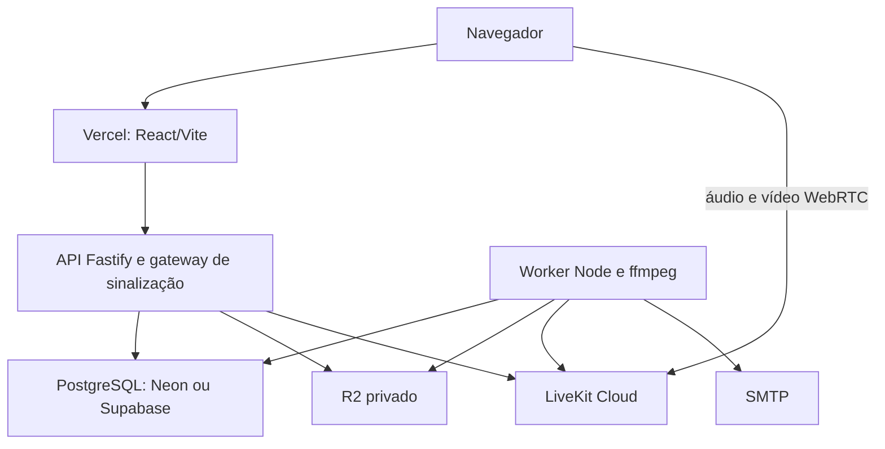

# Noctis — operação distribuída e rollback

Estado: preparação para revisão; **nenhum deploy de produção concluído**.
Leia primeiro [a auditoria](production-audit.md). Supabase é alternativa em
avaliação ao Neon; não foi criado um banco nem migrada a autenticação.

## Arquitetura proposta

O frontend continua usando /api na mesma origem. Não configurar CORS '*',
SameSite=None ou tokens no localStorage para contornar um deploy mal conectado.
API e gateway persistentes ficam fora de Functions nesta proposta inicial;
WebSocket na Vercel existe, mas o ciclo de vida deste backend ainda não foi
adaptado e validado para Functions. Nenhuma API foi reescrita em serverless.
Upstash não é necessário por enquanto.

## Variáveis e segredos

| Destino                                       | Variáveis                                                                                                                                                                                          |
| --------------------------------------------- | -------------------------------------------------------------------------------------------------------------------------------------------------------------------------------------------------- |
| Configuração Vercel, antes de importar/deploy | NOCTIS_BACKEND_ORIGIN (origem HTTPS pública, sem credenciais). Gera vercel.json.                                                                                                                   |
| API e worker                                  | NODE_ENV=production, APP_ORIGIN (URL HTTPS final do frontend), SESSION_SECRET, ENCRYPTION_KEY. Chaves aleatórias diferentes de 32 bytes em hexadecimal, iguais entre réplicas.                     |
| Banco runtime                                 | DATABASE_URL (noctis_api), AUTH_DATABASE_URL (noctis_auth), WORKER_DATABASE_URL (noctis_worker), LISTENER_DATABASE_URL (sessão direta do papel API), DATABASE_SSL=true; DATABASE_CA se necessário. |
| Pools                                         | API_POOL_SIZE=5, AUTH_POOL_SIZE=2, WORKER_POOL_SIZE=2, DB_CONNECT_TIMEOUT_MS=10000 como ponto inicial; ajustar apenas com evidência de carga.                                                      |
| Uploads                                       | STORAGE_DRIVER=r2, STORAGE_PATH absoluto fora da aplicação, R2_ENDPOINT, R2_BUCKET, R2_ACCESS_KEY_ID, R2_SECRET_ACCESS_KEY.                                                                        |
| Mídia                                         | LIVEKIT_INTERNAL_URL (HTTPS do projeto Cloud; WSS também é normalizado no gateway), LIVEKIT_API_KEY e LIVEKIT_API_SECRET, somente no servidor.                                                     |
| SMTP                                          | MAIL_TRANSPORT=smtp, MAIL_FROM, SMTP_HOST, SMTP_PORT, SMTP_USER, SMTP_PASSWORD. Sender validado com o provedor escolhido.                                                                          |
| Música                                        | MUSIC_AUDIO_HOSTS somente para áudio autorizado; FFMPEG_PATH se não estiver no PATH; limites MUSIC_* existentes continuam disponíveis em config.ts.                                                |
| Entrada API                                   | HOST, PORT; TRUST_PROXY_CIDR apenas com ingress confiável verificado.                                                                                                                              |
| Migrations                                    | .env.migration: MIGRATION_DATABASE_URL, DATABASE_SSL=true, DATABASE_CA opcional. Sem URL administrativa nas aplicações.                                                                            |
| OAuth opcional                                | GITHUB/GOOGLE/SPOTIFY/TWITCH_CLIENT_ID e CLIENT_SECRET; callbacks na APP_ORIGIN/api/oauth/PROVIDER/callback.                                                                                       |

Não há necessidade de VITE_DATABASE_URL, chave Supabase service_role, segredo
LiveKit ou credenciais R2 no frontend. Os templates têm campos vazios e não são
configurações utilizáveis até preencher privadamente. Não é preciso colar secrets
no chat. Rotação da ENCRYPTION_KEY exige plano de recriptografia; não trocá-la
aleatoriamente num redeploy porque protege credenciais e e-mails já armazenados.

## Banco: preparação e execução

1. Selecionar projeto e região próximos ao backend, confirmar plano gratuito.
   Não usar projeto com dados de outra aplicação sem revisar isolamento.
2. Executar infra/database-preflight.sql numa conexão administrativa segura.
   Confirmar TLS, PostgreSQL, schema, papéis e public.digest(bytea,text).
3. Provisionar os quatro papéis sem SUPERUSER/BYPASSRLS/CREATEROLE/CREATEDB.
   Revisar infra/provision.sql: o GRANT usa database noctis; no Supabase o database
   costuma ser postgres. Adaptar ao nome real antes de executar. Não executar
   bootstrap de desenvolvimento contra serviço gerenciado.
4. Se pgcrypto já estiver em outro schema, parar e preparar solução compatível
   revisada (por exemplo função wrapper cuidadosamente restrita). Não mover a
   extensão nem alterar migrations existentes como correção automática.
5. API usa papel que não é dono das tabelas; migrator precisa criar schema e
   funções e conceder privilégios aos papéis runtime. Conferir search_path
   noctis,pg_catalog em todas as conexões, inclusive no pooler.
6. Listeners, migrations e locks de sessão: conexão direta ou pooler session.
   Supabase session usa porta 5432 e username PAPEL.PROJECT_REF quando via pooler.
   Copiar host do painel, não derivá-lo da região. Não usar porta transacional 6543
   para LISTEN. Neon listeners devem usar endpoint sem -pooler.
7. Preservar 001–016 e public.schema_migrations. Fazer backup antes de mudar banco.
   Aplicar pelo runner existente com .env.migration, nunca por recriação manual:
   `docker compose -f compose.distributed.yaml --profile tools run --rm migrate`.
   Esse comando modifica o banco; **não foi executado nesta tarefa**.
8. Verificar checksums e testar RLS entre dois usuários e duas comunidades.
   No Supabase, schema noctis não deve ser exposto na Data API; não conceder
   acesso a anon/authenticated por conveniência. Manter backup externo no Free.

## R2 e uploads existentes

Criar bucket privado Standard somente após resolver conta/autorização/cobrança.
Usar credenciais S3 com acesso apenas ao bucket necessário. Não ativar public
access/r2.dev. O browser não fala com o bucket: a API valida sessão, RLS e conteúdo,
depois transmite o objeto. A franquia gratuita R2 não garante bloqueio de excedentes;
monitorar uso e pausar se for solicitada autorização financeira.

Para banco novo e vazio, ativar STORAGE_DRIVER=r2 em API e worker simultaneamente.
Para dados existentes: parar escritas e worker, copiar os arquivos referenciados
em uploads mantendo storage_key, validar tamanho e SHA-256 contra o banco e testar
leitura antes de trocar o driver. Não copiar diretório mail nem arquivos estranhos.
Manter cópia local e manifesto seguro. **Cópia de dados não implementada/executada**;
não trocar driver num ambiente com uploads antigos sem completar esse passo.
Na recuperação, jamais excluir objetos só porque não apareceram num snapshot
parcial: reconciliar metadados, upload_gc e arquivos.

## API, worker e LiveKit

1. Escolher host de containers com orçamento explicitamente aprovado. Não existe
   host gratuito persistente confirmado nesta entrega.
2. Buildar imagem com Dockerfile existente, registrar tag imutável/commit.
   compose.distributed.yaml separa api, worker e migration job; não sobe SFU/banco.
   A API escuta em loopback no host; configurar ingress TLS com suporte a WebSocket.
3. Preencher .env.distributed e .env.migration privadamente. O Dockerfile roda como
   node e já contém ffmpeg; não expor portas do worker.
4. Configurar projeto LiveKit Cloud e substituir LIVEKIT_INTERNAL_URL. Tokens,
   grants, revalidação e gateway são preservados; testar reconnect, expulsão,
   mudança de permissões, mute/deafen, câmera, tela e volume com dois participantes.
5. Configurar SMTP e validar e-mail real com endereço de teste autorizado. A
   autorização para enviar mensagens a terceiros não está implícita: testes
   reais devem usar contas/endereço fornecidos para esse fim.

## Vercel e novos deploys

Usar também a skill de deploy da Vercel em futuras execuções assistidas.
Antes do primeiro deploy, definir NOCTIS_BACKEND_ORIGIN no shell e executar
`npm run configure:vercel`. O script exige HTTPS e cria vercel.json sem sobrescrever
arquivo existente. Revisar e commitar essa configuração pública. Não executar o
gerador no build da Vercel, pois a descoberta de configuração ocorre antes.

Importar repositório/branch na Vercel com raiz '.', framework Vite, npm ci,
build `npm run build:web`, saída dist. O build HTTP/worker permanece no Dockerfile.
A aplicação usa rotas hash, portanto não precisa de fallback que transforme erro
de /api em HTML. Sem URL real de backend, a configuração final não foi gerada.

Fazer preview primeiro, com banco, APP_ORIGIN e credenciais separados de produção.
Verificar repasse de Set-Cookie, Origin, IP confiável e upgrade WS de /api/realtime
e /api/media/rtc[/v1] através das rewrites. **Upgrade pelo proxy Vercel ainda não
validado**; se não funcionar, não promover. Reavaliar ingresso/domínios e apresentar
a menor mudança antes de alterar auth ou protocolo. Validar até 8 MiB de upload
e respostas privadas não cacheadas. Monitorar tráfego do proxy (R2 gratuito não
torna o egress do backend/Vercel gratuito).

Para novos deploys: branch → npm ci → typecheck → testes → builds → preview →
15 fluxos abaixo → promoção. Não aplicar migrations no build do frontend.
Não mudar para Hobby se a conta não for elegível ao uso pessoal não comercial.

## Gate de aceitação — todos ainda pendentes em ambiente distribuído real

| Fluxo      | Evidência necessária                                                      |
| ---------- | ------------------------------------------------------------------------- |
| Frontend   | Página, fontes/assets, CSP, console e rotas após refresh.                 |
| Cadastro   | Nova conta e unicidade; nenhuma senha/token nos logs.                     |
| Login      | Cookie seguro, sessão inválida recusada, limite de tentativas.            |
| E-mail     | Receber, verificar, rejeitar link reutilizado/expirado; confirmar worker. |
| Servidor   | Criar, editar, excluir dentro das permissões.                             |
| Canais     | Categoria, canal privado e acesso de não membro.                          |
| Mensagens  | Enviar, editar, reagir, fixar e persistir após reload.                    |
| WebSocket  | Dois navegadores, reconectar após restart, ressincronizar.                |
| Amigos/DM  | Solicitar/aceitar, conversa privada e bloqueio.                           |
| Uploads    | Avatar/anexo, tipo inválido, tamanho máximo, acesso cruzado negado, GC.   |
| Voz        | Dois participantes, entrada/saída, mute/deafen e volume individual.       |
| Vídeo      | Publicação, recepção e mudança de permissão.                              |
| Tela       | Compartilhar/parar e remover permissão de stream.                         |
| Permissões | Duas comunidades, cargo inferior, expulsão e revogação durante chamada.   |
| Missions   | Objetivo, progresso persistido, conclusão e recompensa autorizada.        |

## Rollback

- Registrar deployment anterior Vercel, commit da API/worker, env versionado no
  gerenciador seguro e backups do banco/objetos antes de cada promoção.
- Frontend: restaurar deployment anterior por Instant Rollback/painel, observando
  disponibilidade no plano; alternativamente redeploy do commit conhecido.
- API/worker: voltar à imagem imutável anterior e às configurações compatíveis.
- Banco: esta alteração não muda migrations. Não apagar schema_migrations nem
  rodar down destrutivo. Para futura mudança incompatível, restaurar backup em
  banco separado e verificar dados antes de redirecionar conexões.
- R2: depois de novas escritas, reverter apenas STORAGE_DRIVER para local perde
  acesso a esses arquivos. Copiar e reconciliar primeiro, ou manter o adaptador R2
  no rollback. Preservar bucket e credenciais enquanto houver referências.
- LiveKit: voltar ao endpoint anterior somente se o SFU anterior ainda estiver
  disponível; desconectar/reentrar nas salas. Não trocar secrets sem coordenação.

URLs de produção, projeto de banco, bucket, LiveKit e SMTP: **pendentes**.
Migrations aplicadas, arquivos reais migrados e cobranças contratadas: **nenhum**.
